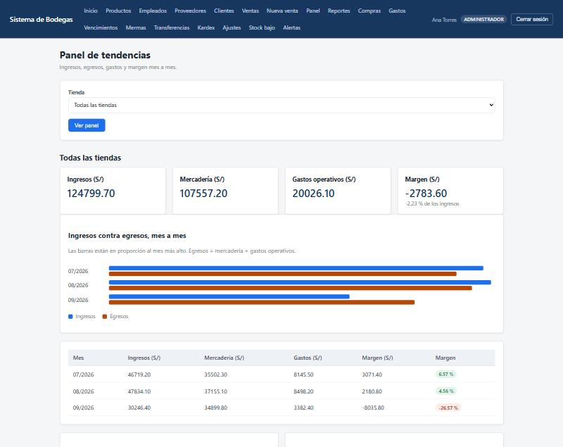
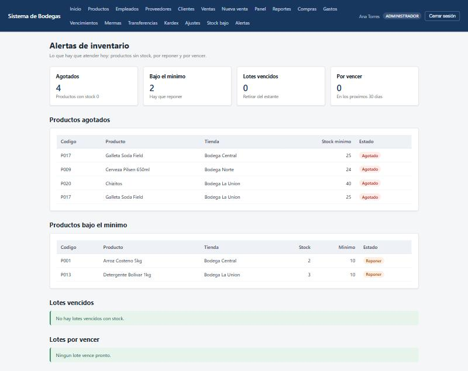
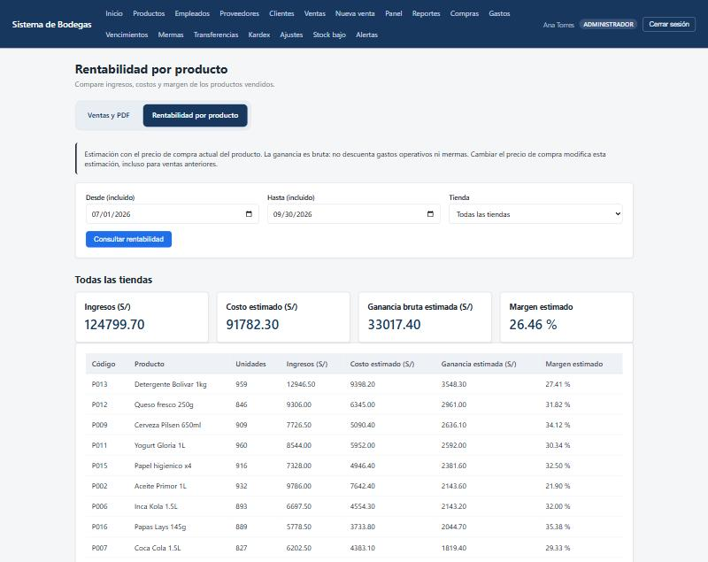
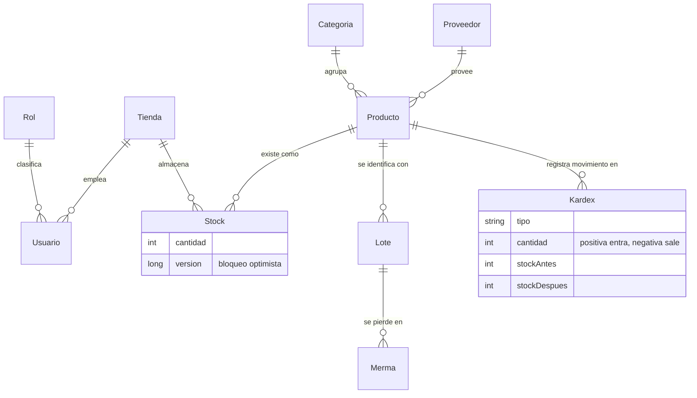

# Sistema de Ventas para Bodegas

Aplicación web para la gestión de una cadena pequeña de bodegas: controla el
inventario por tienda, el abastecimiento, los gastos operativos y entrega
reportes de ventas y rentabilidad.

El inventario es **por tienda, no global**, y toda operación que mueve stock
queda registrada en un kardex con el saldo antes y después del movimiento.

---

## Tabla de contenidos

- [Vistas](#vistas)
- [Funcionalidades](#funcionalidades)
- [Tecnologías](#tecnologías)
- [Arranque rápido con Docker](#arranque-rápido-con-docker)
- [Despliegue](#despliegue)
- [Instalación sin Docker](#instalación-sin-docker)
- [Configuración](#configuración)
- [Base de datos](#base-de-datos)
- [Pruebas](#pruebas)
- [Estructura del proyecto](#estructura-del-proyecto)
- [Estado y limitaciones](#estado-y-limitaciones)
- [Desarrollo](#desarrollo)

---

## Vistas

**Panel de tendencias** — ingresos, egresos y margen mes a mes, con filtro por
tienda.



**Alertas de inventario** — productos agotados, por debajo del mínimo, y lotes
vencidos o por vencer.



**Rentabilidad por producto** — ingresos, costo estimado y margen por
producto, en un rango de fechas.



---

## Funcionalidades

### Seguridad y control de acceso
Autenticación por formulario con tres roles (administrador, manager y
vendedor), protección CSRF y control de sesión. Cada usuario pertenece a una
tienda y el sistema valida que no pueda consultar ni modificar datos de otra.
Las claves se almacenan con BCrypt. Toda operación sensible queda en una
bitácora de auditoría con usuario, acción, dirección IP y resultado.

### Inventario y logística
Stock por tienda, transferencias entre tiendas, ajustes por conteo físico y
kardex con el saldo antes y después de cada movimiento. Alertas de productos
agotados, por debajo del mínimo, vencidos y por vencer.

### Abastecimiento
Registro de compras a proveedores, que aumenta el stock y deja la entrada
correspondiente en el kardex dentro de una sola transacción. Registro de
gastos operativos por categoría.

### Trazabilidad de lotes
Los lotes identifican el stock existente con su código de envase y fecha de
vencimiento. Las mermas descuentan el saldo del lote y el stock a la vez, con
motivo y descripción. Al transferir mercadería, los lotes viajan con ella
conservando código y vencimiento.

### Caja diaria
Apertura con monto inicial, registro de entradas y salidas de efectivo, y
cierre con arqueo:

```
efectivo esperado = monto inicial + ventas del turno + entradas - salidas
diferencia        = efectivo contado - efectivo esperado
```

### Reportes y panel de control
Reporte de ventas exportable a PDF, rentabilidad por producto, y un panel de
tendencias que cruza ingresos, egresos de mercadería y gastos operativos mes a
mes para mostrar el margen.

### Clientes
Mantenimiento de clientes con baja lógica.

---

## Tecnologías

| | |
|---|---|
| Lenguaje | Java 17 |
| Framework | Spring Boot 3.3.5 (MVC, Data JPA, Security, Validation) |
| Vistas | Thymeleaf |
| Base de datos | MySQL 8 |
| Reportes | JasperReports 6.21.3 |
| Construcción | Maven |
| Pruebas | JUnit 5, Mockito, Spring Test, H2 |
| Contenedores | Docker y Docker Compose |

---

## Arranque rápido con Docker

**Requisito único:** Docker Desktop. No hace falta instalar Java, Maven ni
MySQL.

```bash
docker compose up -d
```

Eso levanta dos contenedores:

| Servicio | Qué es | Puerto |
|---|---|---|
| `app` | La aplicación | 8080 |
| `mysql` | MySQL 8 con la base ya creada y poblada | 3306 |

La aplicación queda en <http://localhost:8080>. La primera ejecución tarda
unos minutos porque compila el proyecto; las siguientes arrancan en segundos.

```bash
docker compose logs -f app   # seguir el log
docker compose down          # detener
docker compose down -v       # detener y borrar la base
```

### Modo desarrollo

Monta el código fuente dentro del contenedor y recompila al guardar:

```bash
docker compose --profile dev up app-dev
```

El proyecto también incluye configuración de **Dev Container** para VS Code:
`F1` → *Dev Containers: Reopen in Container* abre el editor dentro del
contenedor, con Java 17 y Maven ya disponibles.

---

## Despliegue

El `Dockerfile` tiene tres etapas. La etapa `runtime` produce una imagen
mínima, con solo el JRE y el JAR, apta para desplegar en cualquier servidor
con Docker.

```bash
docker build --target runtime -t sistema-bodega:1.0 .
```

Para ejecutarla contra una base de datos externa, basta con pasarle las
variables de entorno:

```bash
docker run -d \
  -p 8080:8080 \
  -e SPRING_DATASOURCE_URL="jdbc:mysql://servidor:3306/bodegadb?useSSL=true&serverTimezone=America/Lima" \
  -e DB_USER=usuario \
  -e DB_PASSWORD=clave \
  --name sistema-bodega \
  sistema-bodega:1.0
```

La imagen no contiene credenciales: se resuelven en tiempo de ejecución. La
base de datos debe existir y tener el esquema aplicado; ver
[Base de datos](#base-de-datos).

Para un despliegue con la base incluida, `docker compose up -d` sirve tal
cual: el volumen `bodega-datos` persiste la información entre reinicios.

---

## Instalación sin Docker

Para ejecutar el proyecto de forma nativa hacen falta JDK 17, Maven 3.9 y
MySQL 8.

En Windows hay scripts que automatizan el proceso con `winget`:

```bash
.\scripts\verificar.ps1      # informa qué falta, sin instalar nada
.\scripts\instalar.ps1       # instala JDK 17, Maven, MySQL y Git
.\scripts\mysql-iniciar.ps1  # arranca el servidor MySQL
.\scripts\setup-bd.ps1       # crea la base y carga los datos de prueba
.\scripts\iniciar.ps1        # levanta la aplicación
```

Después de instalar hay que abrir una terminal nueva: Windows no refresca el
`PATH` en las que ya estaban abiertas.

En otros sistemas, con las herramientas ya instaladas:

```bash
mysql -u root -p < db/01_script_bd.sql     # y el resto de scripts en orden
mvn spring-boot:run
```

---

## Configuración

Las credenciales se resuelven en este orden de prioridad:

| | Origen | Uso |
|---|---|---|
| 1 | `application-local.properties` | Configuración personal, no se versiona |
| 2 | Variables de entorno | Despliegue y contenedores |
| 3 | `application.properties` | Valores por defecto del proyecto |

Variables reconocidas:

| Variable | Por defecto |
|---|---|
| `SPRING_DATASOURCE_URL` | `jdbc:mysql://localhost:3306/bodegadb` |
| `DB_USER` | `root` |
| `DB_PASSWORD` | *(vacío)* |

Para una configuración local, copiar la plantilla incluida:

```bash
cp application-local.properties.ejemplo application-local.properties
```

Ese archivo está en `.gitignore` y nunca se comparte.

---

## Base de datos

El esquema se crea con los scripts de `db/`, que deben ejecutarse en orden:

| Script | Contenido |
|---|---|
| `01_script_bd.sql` | Base, tablas principales y datos de prueba |
| `02_datos_demo.sql` | Volumen de ventas, compras y gastos de demostración |
| `03_inventario_logistica_tarea7.sql` | Kardex, transferencias y ajustes |
| `04_inventario_sin_borrar.sql` | Versión no destructiva del anterior |
| `05_lotes_mermas.sql` | Lotes y mermas |
| `06_clientes.sql` | Clientes |
| `06_seguridad_caja.sql` | Auditoría y caja diaria |

Con Docker se aplican solos la primera vez que se crea el volumen.

La aplicación corre con `spring.jpa.hibernate.ddl-auto=validate`: Hibernate
**no** modifica el esquema, solo comprueba al arrancar que las entidades
coinciden con las tablas. Si algo no calza, la aplicación falla de inmediato
con un mensaje que indica la columna exacta, en lugar de alterar la base en
silencio.

---

## Pruebas

```bash
docker compose --profile dev run --rm --no-deps app-dev mvn -B test
```

o, con Maven instalado, `mvn test`.

**189 pruebas** en dos niveles:

**Unidad y slice.** Lógica de servicio con Mockito y capa web con
`@WebMvcTest`, rápidas y aisladas.

**Integración de punta a punta.** `@SpringBootTest` que levanta la aplicación
completa —controladores, servicios, repositorios, Hibernate y la cadena de
filtros real de Spring Security— contra una base H2 en memoria que se vacía y
se vuelve a poblar antes de cada prueba. Las consultas JPQL se ejecutan de
verdad y la matriz de permisos se verifica ruta por ruta y rol por rol.

Cada Pull Request dispara dos workflows de GitHub Actions: uno compila y
publica el JAR como artifact, el otro ejecuta la suite y guarda los reportes.

---

## Estructura del proyecto

```
src/main/java/pe/edu/cibertec/bodega/
├── model/        22 entidades JPA
├── repository/   22 repositorios Spring Data
├── controller/   rutas y vistas
├── service/      lógica de negocio y transacciones
├── dto/          formularios y resultados de reporte
└── security/     autenticación, roles y filtrado por tienda

src/main/resources/
├── templates/    vistas Thymeleaf, con fragmentos comunes
├── static/css/   hoja de estilos
└── reportes/     plantillas JasperReports (.jrxml)

src/test/java/pe/edu/cibertec/bodega/
├── controller/   @WebMvcTest
├── service/      pruebas de unidad
└── e2e/          @SpringBootTest contra base real

db/               scripts SQL
scripts/          instalación y arranque nativos en Windows
docs/             documentación por módulo
```

### Modelo de datos



El inventario es **por tienda**: `Stock` cruza producto × tienda. Toda
operación que mueve stock deja una fila en `Kardex` con el saldo antes y
después.

`Stock` lleva un campo `version` con `@Version`: es el bloqueo optimista que
impide que dos cajas vendan simultáneamente la misma última unidad. Las
operaciones que compiten por stock usan además bloqueo pesimista al leer la
fila.

El modelo completo, los flujos de cada operación y las reglas de concurrencia
están en [docs/ARQUITECTURA.md](docs/ARQUITECTURA.md).

---

## Estado y limitaciones

El sistema está operativo y la suite completa pasa. Quedan tres puntos
abiertos, documentados por transparencia:

- **Caja diaria:** la lógica de apertura, movimientos y arqueo está
  implementada y cubierta por pruebas, pero falta la plantilla de la pantalla,
  por lo que la ruta `/caja` no es accesible desde el navegador.
- **Consulta de auditoría:** la bitácora se registra correctamente y existe su
  plantilla, pero falta el controlador que la publique en
  `/seguridad/auditoria`.
- **Módulos en integración:** los mantenimientos de catálogo y el registro de
  ventas están desarrollados en ramas que aún no se han integrado a `Dev`.
  Hasta que se integren, los enlaces correspondientes del menú no resuelven.

Las pruebas de integración generan el esquema a partir de las entidades JPA,
no de los scripts de `db/`, porque estos usan sintaxis específica de MySQL. La
correspondencia entre entidades y esquema la valida `ddl-auto=validate` al
arrancar contra MySQL.

---

## Desarrollo

La rama de integración es `Dev`. El trabajo se hace en ramas propias y se
integra mediante Pull Request, que debe pasar los dos workflows de CI antes de
fusionarse.

Convenciones del proyecto:

- No modificar `spring.jpa.hibernate.ddl-auto`. Está en `validate` a propósito.
- Un cambio de esquema va primero al script SQL y después a la entidad.
- Las pantallas nuevas reutilizan los fragmentos de
  `templates/fragments/comunes.html`, y sus enlaces en el menú llevan el
  `sec:authorize` correspondiente a su rol.

### Documentación

| Documento | Contenido |
|---|---|
| [docs/ARQUITECTURA.md](docs/ARQUITECTURA.md) | Modelo de datos, flujos de cada operación y reglas de concurrencia |
| [docs/SEGURIDAD-CONTROL-ACCESO.md](docs/SEGURIDAD-CONTROL-ACCESO.md) | Roles, matriz de permisos, filtrado por tienda, caja y auditoría |
| [docs/INVENTARIO-Y-LOGISTICA.md](docs/INVENTARIO-Y-LOGISTICA.md) | Kardex, transferencias, ajustes y alertas |
| [docs/ABASTECIMIENTO-Y-REPORTES.md](docs/ABASTECIMIENTO-Y-REPORTES.md) | Compras, gastos, lotes, mermas y reportes |
| [docs/EQUIPO.md](docs/EQUIPO.md) | Reparto de módulos y convenciones de trabajo |
| [CHANGELOG.md](CHANGELOG.md) | Qué entró en cada integración |

Antes de tocar código que mueva stock, conviene leer la sección de
concurrencia de `ARQUITECTURA.md`: el orden en que se toman los bloqueos es un
acuerdo del proyecto, no un detalle de implementación.
