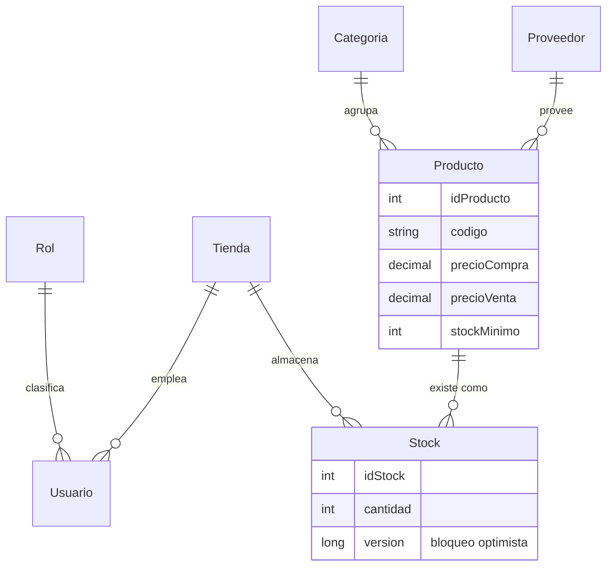
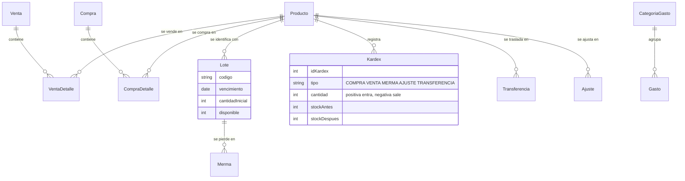
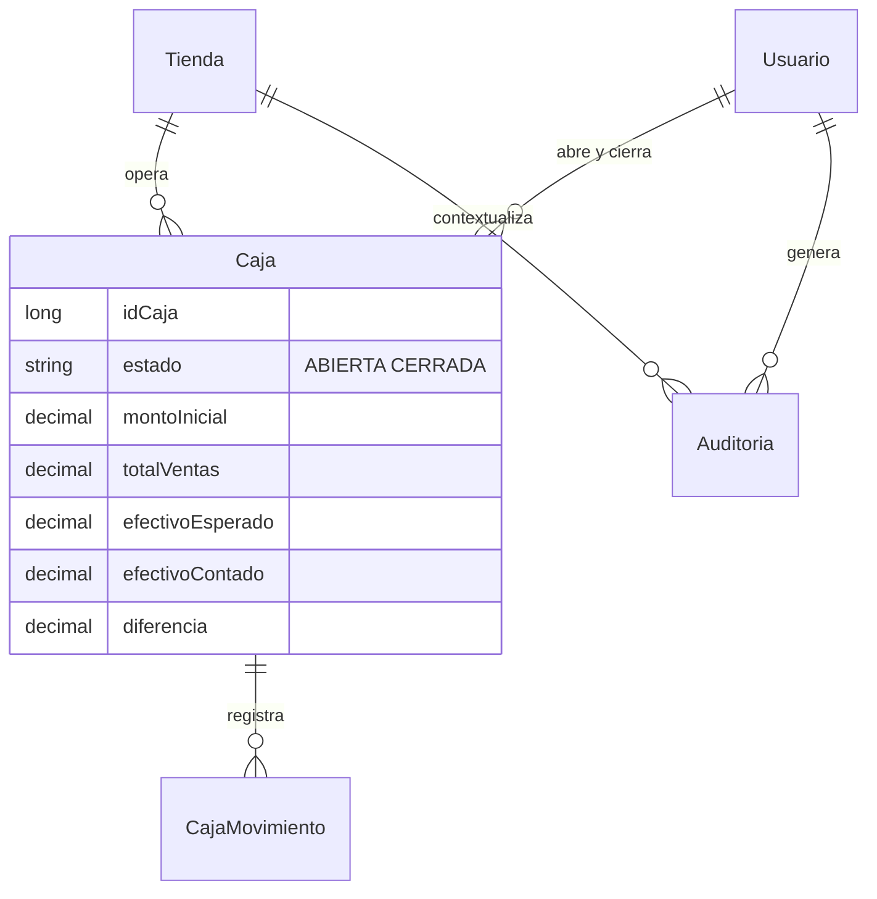
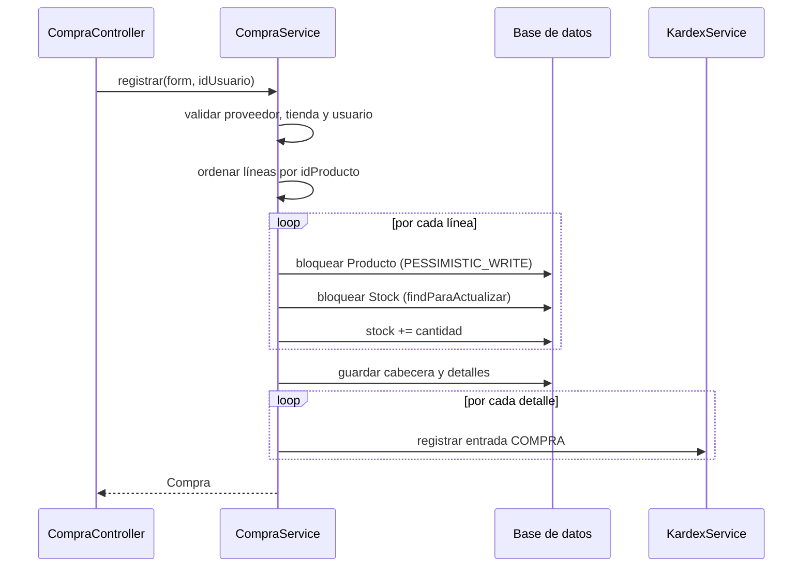
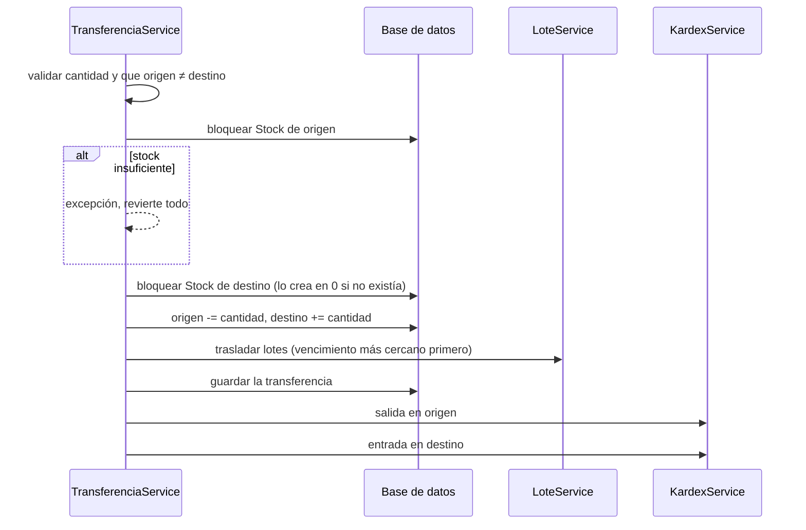
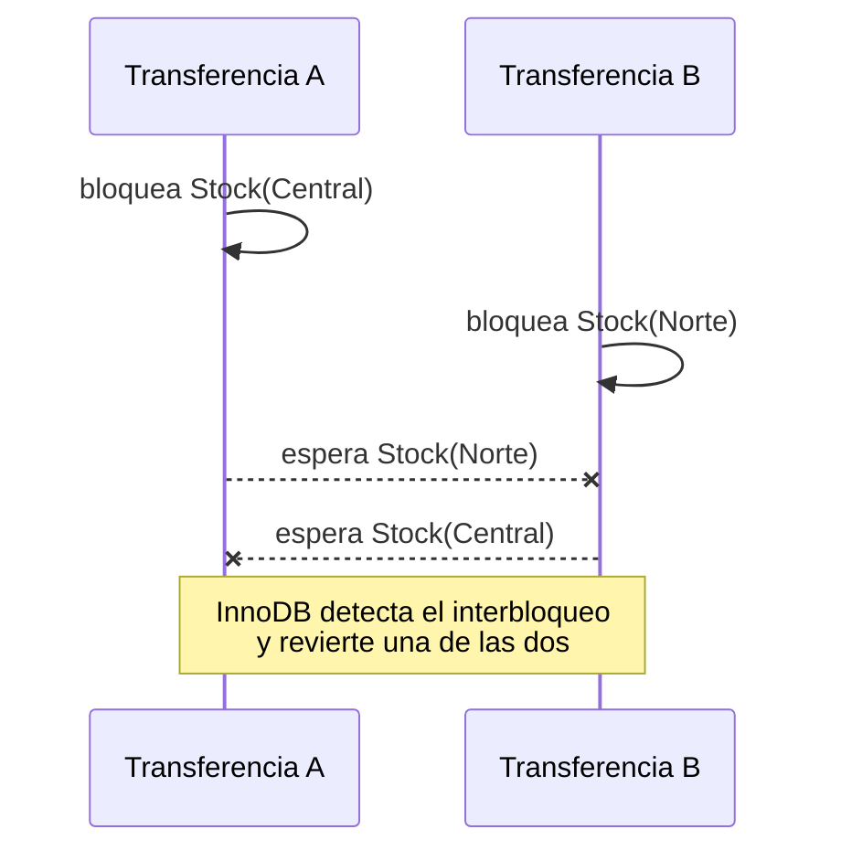

# Arquitectura

Decisiones de diseño que atraviesan varios módulos. Si vas a tocar algo que
mueva stock, leé primero la sección de [concurrencia](#concurrencia-y-bloqueos).

---

## Modelo de datos

El modelo se entiende mejor en tres partes.

### Catálogo e inventario

El inventario es **por tienda**: `Stock` cruza producto × tienda. Una bodega
puede tener veinte unidades de algo y otra ninguna.



`Producto` guarda precio de compra **y** de venta: de su diferencia sale el
margen que alimenta el reporte de rentabilidad y el panel.

### Movimientos

Todo lo que altera el stock deja una fila en `Kardex`, con el saldo antes y
después. Es el historial único del inventario.



### Seguridad y caja



---

## Flujos principales

### Registrar una compra

Una sola transacción: si algo falla, no queda nada a medias.



### Transferir entre tiendas

Toca dos tiendas a la vez. El total del sistema no cambia: lo que sale de una
entra en la otra.



### Cerrar caja con arqueo

```
efectivo esperado = monto inicial + ventas del turno + entradas - salidas
diferencia        = efectivo contado - efectivo esperado
```

Las ventas del turno salen de `VentaRepository.totalVentasCaja`, acotadas
entre la apertura y el cierre, y **solo cuentan las activas**: una venta
anulada no debe inflar el efectivo que se espera encontrar en la caja.

---

## Concurrencia y bloqueos

Dos cajas pueden vender la misma última unidad al mismo tiempo. El sistema usa
dos mecanismos distintos, y conviene saber cuál aplica cuándo.

### Bloqueo optimista

`Stock` y `Lote` llevan un campo `version` con `@Version`. Si dos
transacciones leen la misma fila y ambas intentan escribirla, la segunda falla
al confirmar. Sirve como red de seguridad cuando no hubo bloqueo explícito.

### Bloqueo pesimista

Las operaciones que leen el stock *para modificarlo* lo bloquean en la base de
datos mientras dura la transacción:

| Método | Qué bloquea |
|---|---|
| `StockRepository.findParaActualizar` | Una fila de stock (producto × tienda) |
| `LoteRepository.bloquear` | Un lote concreto |
| `LoteRepository.bloquearDisponibles` | Los lotes con saldo de un producto en una tienda |

**Usar siempre `findParaActualizar`, nunca el `findBy` normal**, en cualquier
código que vaya a escribir el stock. Esa es la regla que evita la sobreventa.

### Orden de bloqueo

Cuando una transacción bloquea más de una fila, el **orden importa**: si dos
transacciones toman los mismos bloqueos en orden distinto, se quedan esperando
una a la otra.

El proyecto acordó este orden:

1. `Producto`, luego `Stock`, luego `Lote`.
2. Cuando hay varios productos, por `idProducto` ascendente.

Quién lo respeta hoy:

| Servicio | Orden |
|---|---|
| `CompraService` | Ordena las líneas por `idProducto` y bloquea producto → stock |
| `MermaService` | Bloquea stock → lote, con el comentario explícito del acuerdo |
| `LoteService` | Bloquea el stock antes de tocar lotes |
| `AjusteService` | Bloquea una sola fila de stock |

### Riesgo conocido: transferencias cruzadas

`TransferenciaService` bloquea **origen y después destino, en el orden en que
llegan**, sin ordenarlos:

```java
Stock stockOrigen  = stockRepo.findParaActualizar(idProducto, idOrigen);
// ...
Stock stockDestino = stockRepo.findParaActualizar(idProducto, idDestino);
```

Si se ejecutan a la vez dos transferencias opuestas del mismo producto
—Central → Norte y Norte → Central— cada una toma primero el bloqueo que la
otra necesita después:



**Impacto:** InnoDB detecta el interbloqueo y revierte una de las
transacciones. No hay pérdida ni corrupción de datos, pero el usuario recibe
un error técnico en una operación que debería haber funcionado o esperado su
turno.

**Cómo se arregla:** bloquear las dos filas en orden de `idTienda` ascendente,
en vez de origen primero, igual que hace `CompraService` con los productos. La
dirección del movimiento no cambia; solo el orden en que se piden los
bloqueos.

Las pruebas actuales no lo detectan: H2 no reproduce el interbloqueo de InnoDB
y la suite no ejecuta transferencias en paralelo.

---

## Transacciones

Toda operación que toca más de una tabla va dentro de un `@Transactional`. El
criterio es que el sistema nunca quede a medias:

- Una compra que aumenta el stock pero no guarda el detalle sería stock
  fantasma.
- Una merma que descuenta el lote pero no el stock los dejaría descuadrados.
- Una transferencia que resta en origen pero no suma en destino evaporaría
  mercadería.

Las pruebas de integración verifican justamente eso: ante un fallo, comprueban
que no quedó ni el movimiento, ni el kardex, ni el cambio de stock.

`LoteService.trasladar` usa `@Transactional(propagation = MANDATORY)`: se
niega a ejecutarse fuera de una transacción ajena, porque depende de que quien
la llama ya tenga los bloqueos tomados.

---

## Validación del esquema

La aplicación corre con `spring.jpa.hibernate.ddl-auto=validate`. Hibernate no
modifica el esquema: solo comprueba al arrancar que las entidades coinciden
con las tablas.

Es deliberado. Con `update`, una entidad mal escrita deforma la base en
silencio y el error aparece semanas después. Con `validate`, la aplicación no
arranca y el mensaje indica la columna exacta.

La consecuencia práctica: **un cambio de esquema va primero al script SQL de
`db/` y después a la entidad.** Al revés, la aplicación no levanta.
